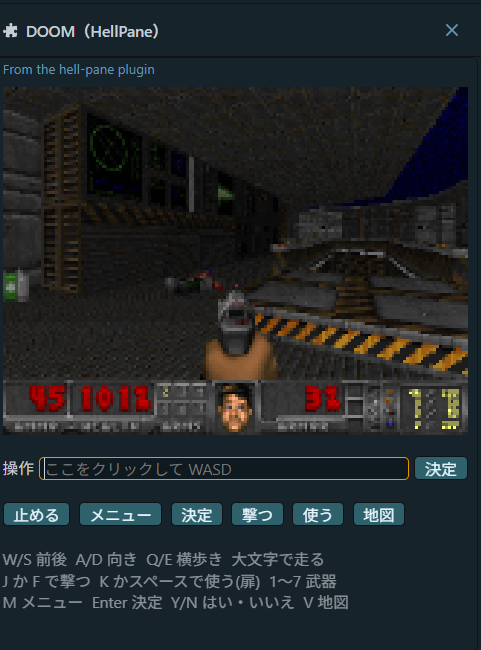
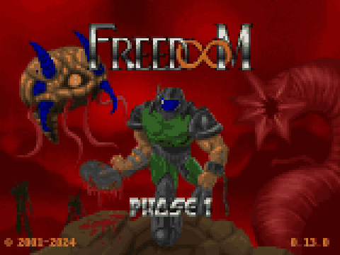

# DOOM（HellPane）

Claude Code のペインで、本物の DOOM を遊ぶ mod です。`/doom` で開き、Claude の返事を待つ間に 1 面だけ遊べます。





画像のマップと絵は [Freedoom](https://freedoom.github.io/) のものです。

> English: A Claude Code mod that runs the real DOOM engine ([doomgeneric](https://github.com/ozkl/doomgeneric)) as a child process and draws it in a pane. Type `/doom`, click the input field and play with WASD. Windows only for now. GPL-2.0.

## しくみ

- DOOM 本体は [doomgeneric](https://github.com/ozkl/doomgeneric) です。Windows 用の exe(`hellpane-engine.exe`)として、別プロセスで動きます。mod の中ではコンパイル済みのコードを動かせないためです
- エンジンは絵を 1 枚ずつ標準出力に書きます(1 秒に約 20 枚)。mod はそれを受け取って、ペインに描きます
  - **VS Code**: SVG に画像を埋め込んで描きます(1 秒に 10 回まで)
  - **ターミナル**: 文字マスのドット絵(▀ で縦 2 ドット)で描きます
- キーは、ペインの入力欄に打った文字を mod が DOOM のキーに変え、ファイル経由でエンジンに渡します。端末は「キーを離した」を送らないので、しばらく押されなければ離したことにしています

## 操作

ペインの「操作」欄をクリックしてから打ちます。押しっぱなしで歩き続けます。

| キー | 動き |
|---|---|
| W / S | 前 / 後ろ |
| A / D | 向きを変える |
| Q / E | 横歩き |
| 大文字(Shift) | 走る |
| J / F | 撃つ |
| K / スペース | 使う(扉・スイッチ) |
| 1〜7 | 武器 |
| M | メニュー(Esc の代わり) |
| Enter | 決定 |
| Y / N | はい / いいえ |
| V | 地図 |

ボタン(止める・メニュー・決定・撃つ・使う・地図)でも操作できます。ペインを閉じるとエンジンも止まります。

## 動く環境

- Windows 10 / 11(エンジンの exe が Windows 用です)
- Claude Code 2.1.301 で確かめました。VS Code 拡張・ターミナルのどちらでも動きます
- Claude Code の関数フック mod の API は先行公開の段階で、版によって変わることがあります

## 入れ方

### 1. mod を入れる

ターミナルの Claude Code の入力欄で:

```
/plugin install hell-pane --marketplace takosasi-dev/doom-hell-pane
```

`y` でマーケットプレイスを足し、スコープを選ぶと入ります。シェルからは:

```sh
claude plugin install hell-pane --marketplace takosasi-dev/doom-hell-pane
```

### 2. エンジンと WAD を置く

ホームの `.hellpane` フォルダ(`%USERPROFILE%\.hellpane`)に、次の 2 つを置きます。

| ファイル | 入手先 |
|---|---|
| `hellpane-engine.exe` | [Releases](https://github.com/takosasi-dev/doom-hell-pane/releases) からダウンロード(ソースからのビルドは下を参照) |
| `freedoom1.wad` | [Freedoom](https://freedoom.github.io/download.html) の zip の中にあります |

手持ちの `doom1.wad`(シェアウェア版)や `doom.wad` で遊びたい時は、`/plugin` の設定で **WAD path** にそのファイルの絶対パスを入れます。エンジンと設定・セーブの置き場所も、**Engine path** と **Data folder** で変えられます。

このリポジトリには WAD を入れていません。

### 3. 遊ぶ

Claude Code を開き直して `/doom` を打ちます。`/doom` がほかの mod と被った時は `/hell-pane` で開きます。

## ソースからビルドする

[llvm-mingw](https://github.com/mstorsjo/llvm-mingw) か MinGW-w64 の `gcc`(または `clang`)が PATH にある状態で:

```powershell
git clone https://github.com/takosasi-dev/doom-hell-pane
cd doom-hell-pane
powershell -ExecutionPolicy Bypass -File engine\build.ps1
```

`plugin\bin\hellpane-engine.exe` ができます。`plugin\wad\freedoom1.wad` を置けば、そのまま試せます。

```sh
claude --plugin-dir plugin
```

mod の検査とテスト:

```sh
claude plugin validate plugin
claude plugin test plugin
```

## フォルダ

| 場所 | 中身 |
|---|---|
| `plugin/` | Claude Code の mod(`hell-pane`) |
| `engine/` | doomgeneric の Windows 用の部品(絵を標準出力へ、キーをファイルから)とビルドスクリプト |
| `doomgeneric/` | doomgeneric のソース(手を入れていない写し。[UPSTREAM.md](doomgeneric/UPSTREAM.md)) |

## ライセンス

GPL-2.0 です([LICENSE](LICENSE))。DOOM のソース(doomgeneric)が GPL-2.0 で、それと一緒に動く物として配るため、MIT ではなく GPL にしています。

- DOOM のソース: id Software と Chocolate Doom・doomgeneric の作者たち(GPL-2.0)
- Freedoom は BSD 系のライセンスで、このリポジトリには含みません
- DOOM は id Software の商標です。このプロジェクトは id Software・Bethesda とは関係ありません
